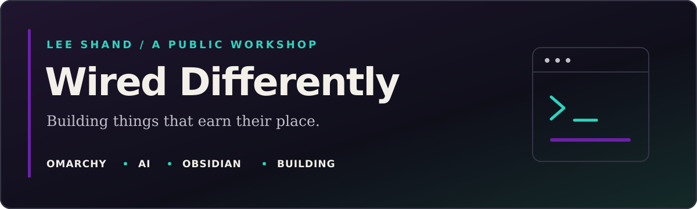

  

  <a href="https://wireddifferently.dev"><strong>Explore Wired Differently</strong></a>
  &nbsp; · &nbsp;
  <a href="https://shaggyrs6.substack.com"><strong>Read on Substack</strong></a>
  &nbsp; · &nbsp;
  <a href="https://github.com/shaggyrs6-netizen/omarchy-briefing"><strong>Try Omarchy Briefing</strong></a>

## Hi, I'm Lee.

I build things to solve problems I actually run into. Usually with Linux, Obsidian and an AI helping me work through it.

Some become plugins. Some become workflows. Some turn out not to help. I write about what happened, not just what was supposed to happen.

This is the code side of **Wired Differently**. The [website](https://wireddifferently.dev) is the workshop; [Substack](https://shaggyrs6.substack.com) is where I tell the stories behind it.

---

## 01 · Omarchy

Linux is my everyday desktop. I build small tools for the gaps I notice while using it: what changed, why I installed something, and how to get back to what I was doing.

### Featured project: [Omarchy Briefing](https://github.com/shaggyrs6-netizen/omarchy-briefing)

**Package updates explained, Omarchy news, and a record of your Linux changes — in one bar plugin.**

- See installed package changes with plain-English context.
- Catch up on official and community Omarchy news.
- Use **My Linux changes** to detect package and plugin changes, then add your own reasons, backup details and undo notes.

Automatic detection can tell you *what* changed. You supply the *why*. Your journal stays local.

[Browse the source and installation instructions →](https://github.com/shaggyrs6-netizen/omarchy-briefing)

## 02 · AI in practice

I use AI as a building partner and a way to keep hold of context. Turning an idea into something I can test, working through a problem, or picking up after an interruption.

The useful question isn't whether an AI can produce something impressive. It's whether the result earns a place in everyday use.

## 03 · Obsidian

Notes are useful when they help me return to the work. I use Obsidian for linked context, project notes and handoffs: what happened, what matters, and what comes next.

The aim is less time reconstructing yesterday, not more time maintaining a system.

## 04 · On the workbench

Plugins, local AI experiments and small tools built around real friction. I test them in my own setup and keep the distinction between an experiment, something I use, and a public release clear.

For the wider work, including projects that aren't public code, visit [Wired Differently](https://wireddifferently.dev).

---

**Follow the work:** [Projects and experiments](https://wireddifferently.dev) · [Writing on Substack](https://shaggyrs6.substack.com)
